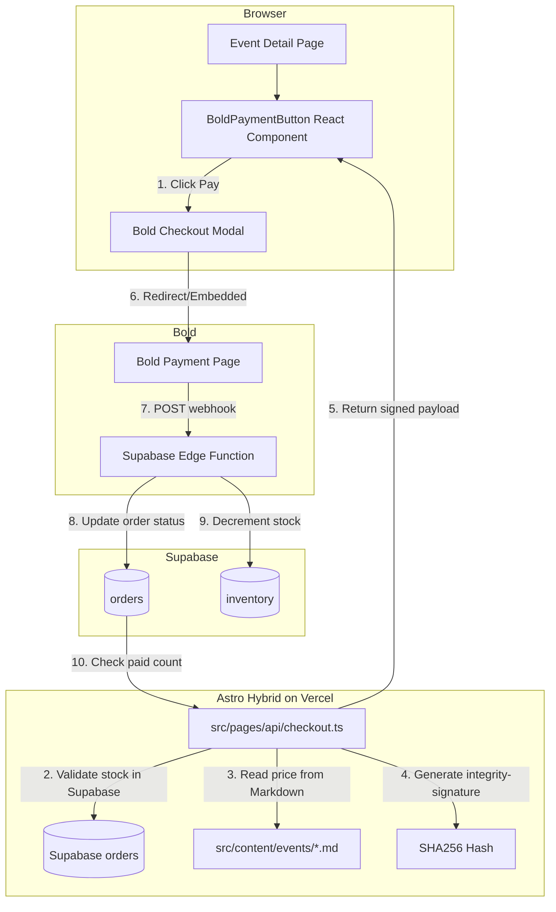
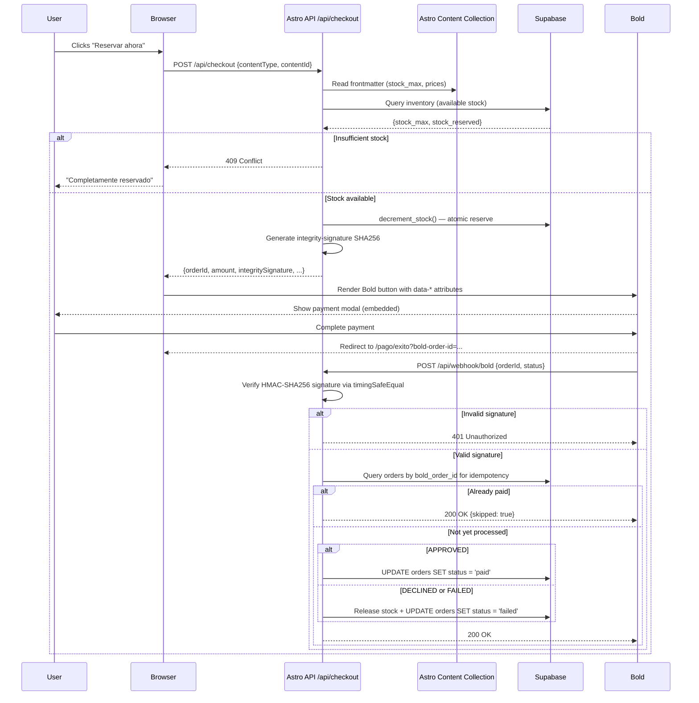

# Bold Payment Gateway + Supabase — Implementation Plan

## Architecture Overview



---

## Phase 0 — Project Configuration & Dependencies

### Files to modify

#### [`astro.config.mjs`](astro.config.mjs)
- Change `output: 'static'` → `output: 'hybrid'`
- Keep `integrations: [react()]` as-is

Rationale: Hybrid mode allows static generation of content pages while enabling dynamic API routes under `src/pages/api/`. No server running cost — Vercel scales API routes to zero when idle.

#### [`.env.example`](.env.example)
Replace old Mercado Pago entries with Bold keys:

```env
# Bold API Keys
BOLD_API_KEY="pk_live_xxxxxxxxx"
BOLD_SECRET_KEY="sk_live_xxxxxxxxx"
BOLD_WEBHOOK_SECRET="whsec_xxxxxxxxx"

# Supabase
PUBLIC_SUPABASE_URL="https://xxxxx.supabase.co"
PUBLIC_SUPABASE_ANON_KEY="eyJhbGciOi..."
SUPABASE_SERVICE_ROLE_KEY="eyJhbGciOi..."

# Site
PUBLIC_SITE_URL="https://varsana.co"
```

#### [`package.json`](package.json)
Add dependencies (as dev commands for user to run):
```bash
npm install @supabase/supabase-js
npm install @supabase/ssr
```

#### [`src/lib/supabase.ts`](src/lib/supabase.ts) — NEW FILE
```typescript
import { createClient } from '@supabase/supabase-js';

const supabaseUrl = import.meta.env.PUBLIC_SUPABASE_URL;
const supabaseAnonKey = import.meta.env.PUBLIC_SUPABASE_ANON_KEY;

export const supabase = createClient(supabaseUrl, supabaseAnonKey);

/**
 * Admin client — only importable in API routes / server context.
 * Uses SERVICE_ROLE key, bypasses RLS.
 */
export function getAdminClient() {
  return createClient(
    supabaseUrl,
    import.meta.env.SUPABASE_SERVICE_ROLE_KEY,
    { auth: { autoRefreshToken: false, persistSession: false } }
  );
}
```

**Security Validation:** Anon key is safe for client-side. Service role key is NEVER imported in client components — only in server-side API routes.

---

## Phase 1 — Supabase Schema (Database)

### Migration file: [`supabase/migrations/001_orders_inventory.sql`](supabase/migrations/001_orders_inventory.sql) — NEW FILE

#### Table: `orders`

| Column | Type | Constraints | Description |
|--------|------|-------------|-------------|
| `id` | `uuid` | PK, default `gen_random_uuid()` | Internal primary key |
| `bold_order_id` | `text` | UNIQUE, NOT NULL | Order ID sent to Bold (e.g., `event-holi-fest-2026-1712345678`) |
| `content_type` | `text` | NOT NULL, CHECK IN ('event','pasadia') | Which collection |
| `content_id` | `text` | NOT NULL | The `id` from frontmatter (e.g. `holi-fest-2026`) |
| `customer_email` | `text` | | From Bold customer-data |
| `customer_name` | `text` | | From Bold customer-data |
| `amount` | `integer` | NOT NULL | Price in COP paid |
| `currency` | `text` | DEFAULT 'COP' | |
| `status` | `text` | NOT NULL, DEFAULT 'pending', CHECK IN ('pending','paid','failed','refunded') | Transaction lifecycle |
| `quantity` | `integer` | DEFAULT 1 | Number of spots reserved |
| `bold_tx_status` | `text` | | Raw status from Bold webhook |
| `created_at` | `timestamptz` | DEFAULT `now()` | |
| `updated_at` | `timestamptz` | DEFAULT `now()` | |

```sql
CREATE TABLE orders (
  id uuid PRIMARY KEY DEFAULT gen_random_uuid(),
  bold_order_id text UNIQUE NOT NULL,
  content_type text NOT NULL CHECK (content_type IN ('event','pasadia')),
  content_id text NOT NULL,
  customer_email text,
  customer_name text,
  amount integer NOT NULL,
  currency text DEFAULT 'COP',
  status text NOT NULL DEFAULT 'pending' CHECK (status IN ('pending','paid','failed','refunded')),
  quantity integer DEFAULT 1,
  bold_tx_status text,
  created_at timestamptz DEFAULT now(),
  updated_at timestamptz DEFAULT now()
);

CREATE INDEX idx_orders_content ON orders(content_type, content_id);
CREATE INDEX idx_orders_status ON orders(status);
CREATE INDEX idx_orders_bold_order_id ON orders(bold_order_id);
```

#### Table: `inventory`

| Column | Type | Constraints | Description |
|--------|------|-------------|-------------|
| `id` | `uuid` | PK, default `gen_random_uuid()` | |
| `content_type` | `text` | NOT NULL, CHECK IN ('event','pasadia') | |
| `content_id` | `text` | NOT NULL | Matches frontmatter `id` |
| `stock_max` | `integer` | NOT NULL | From frontmatter `stock_max` |
| `stock_reserved` | `integer` | DEFAULT 0 | Sum of paid orders |
| `updated_at` | `timestamptz` | DEFAULT `now()` | |

```sql
CREATE TABLE inventory (
  id uuid PRIMARY KEY DEFAULT gen_random_uuid(),
  content_type text NOT NULL CHECK (content_type IN ('event','pasadia')),
  content_id text NOT NULL,
  stock_max integer NOT NULL,
  stock_reserved integer DEFAULT 0,
  updated_at timestamptz DEFAULT now(),
  UNIQUE(content_type, content_id)
);
```

**Design rationale:** `inventory` is a denormalized cache of `stock_max` + orders count. Updated by:
1. The checkout API (optimistic reserve on order creation)
2. The webhook handler (definitive update on payment confirmation)

This avoids counting `orders` rows on every checkout request.

### Helper: [`src/lib/db.ts`](src/lib/db.ts) — NEW FILE

```typescript
import { getAdminClient } from './supabase';

export async function getAvailableStock(contentType: string, contentId: string) {
  const admin = getAdminClient();
  const { data, error } = await admin
    .from('inventory')
    .select('stock_max, stock_reserved')
    .eq('content_type', contentType)
    .eq('content_id', contentId)
    .single();

  if (error || !data) return null;
  return {
    max: data.stock_max,
    reserved: data.stock_reserved,
    available: data.stock_max - data.stock_reserved,
  };
}

export async function reserveStock(contentType: string, contentId: string, quantity: number) {
  const admin = getAdminClient();
  // Atomic increment — only if enough remaining
  const { data, error } = await admin.rpc('decrement_stock', {
    p_content_type: contentType,
    p_content_id: contentId,
    p_quantity: quantity,
  });
  if (error) throw error;
  return data;
}
```

### Database function: [`supabase/migrations/002_decrement_stock.sql`](supabase/migrations/002_decrement_stock.sql) — NEW FILE

```sql
CREATE OR REPLACE FUNCTION decrement_stock(
  p_content_type text,
  p_content_id text,
  p_quantity integer
) RETURNS boolean
LANGUAGE plpgsql
AS $$
DECLARE
  current_reserved integer;
  current_max integer;
BEGIN
  SELECT stock_reserved, stock_max INTO current_reserved, current_max
  FROM inventory
  WHERE content_type = p_content_type AND content_id = p_content_id
  FOR UPDATE;  -- row-level lock

  IF current_reserved IS NULL THEN
    RAISE EXCEPTION 'Inventory record not found for % / %', p_content_type, p_content_id;
  END IF;

  IF (current_reserved + p_quantity) > current_max THEN
    RAISE EXCEPTION 'Insufficient stock: % available, % requested',
      (current_max - current_reserved), p_quantity;
  END IF;

  UPDATE inventory
  SET stock_reserved = stock_reserved + p_quantity,
      updated_at = now()
  WHERE content_type = p_content_type AND content_id = p_content_id;

  RETURN TRUE;
END;
$$;
```

**Security Validation:** `SELECT ... FOR UPDATE` row-locks the inventory row, preventing race conditions when two users try to book the last spot simultaneously.

---

## Phase 2 — Checkout API Endpoint (Integrity Hash)

### [`src/pages/api/checkout.ts`](src/pages/api/checkout.ts) — NEW FILE

```
POST /api/checkout
Content-Type: application/json

{
  "contentType": "event",
  "contentId": "holi-fest-2026",
  "quantity": 1,
  "customerData": {
    "email": "...",
    "fullName": "...",
    "phone": "...",
    "dialCode": "+57"
  }
}
```

**Logic flow:**

```
1. Read contentType + contentId from request body
2. Read the Markdown frontmatter:
   - For events: getCollection('events'), find by entry.id === contentId
   - For pasadias: getCollection('pasadias'), find by entry.id === contentId
3. Extract:
   - stock_max from frontmatter
   - current price via getCurrentPrice(prices) → amount
4. Validate stock in Supabase:
   - Call getAvailableStock(contentType, contentId)
   - If null → upsert inventory row from frontmatter stock_max
   - If (available < quantity) → return 409 Conflict
5. Generate order-id:
   - Format: "{contentType}-{contentId}-{Date.now()}"
   - Example: "event-holi-fest-2026-1712345678"
6. Generate integrity-signature:
   - Input string: "{orderId}{amount}{currency}{BOLD_SECRET_KEY}"
   - SHA256 hex digest via Node crypto
7. Reserve stock in Supabase:
   - Call decrement_stock(contentType, contentId, quantity)
8. Insert order row (status: 'pending')
9. Return signed payload:

{
  "orderId": "event-holi-fest-2026-1712345678",
  "amount": 70000,
  "currency": "COP",
  "integritySignature": "a3f5b8c1...",
  "apiKey": "pk_live_xxxxx",
  "description": "Holi Fest 2026",
  "redirectionUrl": "https://varsana.co/pago/exito?order-id=event-holi-fest-2026-1712345678"
}
```

**Security Validation:**
- Price is read from the **Markdown file**, NOT from the request body — client cannot manipulate the amount.
- Integrity signature uses the **secret key** which never reaches the frontend.
- Stock is validated **before** hash generation — if insufficient, error is returned before any hash is computed.
- The row-level lock in `decrement_stock` prevents double-booking.

---

## Phase 3 — React BoldPaymentButton Component

### [`src/components/BoldPaymentButton.tsx`](src/components/BoldPaymentButton.tsx) — NEW FILE

```tsx
interface BoldPaymentButtonProps {
  contentType: 'event' | 'pasadia';
  contentId: string;
  amount: number;
  description: string;
  onSuccess?: (orderId: string) => void;
  onError?: (error: Error) => void;
}
```

**Component behavior:**

1. **Mount:** Dynamically load `<script src="https://checkout.bold.co/library/boldPaymentButton.js">` into `<head>` (if not already loaded).

2. **On click "Reservar ahora":**
   - Call `POST /api/checkout` with `{ contentType, contentId, quantity: 1, customerData }`
   - Get back signed payload
   - Render a Bold button script tag with attributes:

```tsx
<script
  data-bold-button="dark-L"
  data-api-key={payload.apiKey}
  data-amount={payload.amount}
  data-currency={payload.currency}
  data-order-id={payload.orderId}
  data-integrity-signature={payload.integritySignature}
  data-description={payload.description}
  data-redirection-url={payload.redirectionUrl}
  data-render-mode="embedded"
  data-customer-data={JSON.stringify(customerData)}
/>
```

3. **Listen for payment result:**
   - After redirect back to `redirectionUrl`, parse `?bold-order-id=...&bold-tx-status=...` from URL
   - Show success/failure UI

**States to handle:**

| State | UI |
|-------|-----|
| **Default** | "Reservar ahora" button |
| **Loading** | Spinner + "Verificando disponibilidad..." |
| **No stock** | "Completamente reservado" disabled button |
| **Error** | Red alert with error message + retry button |
| **Success** | Green confirmation with order reference |
| **Embedded modal open** | Bold checkout modal overlays the page |

**Security Validation:** The component never has access to `BOLD_SECRET_KEY`. It receives only the pre-signed payload from the API. Integrity hash is verified by Bold before processing payment.

**Hydration:** When integrated into Astro pages (Phase 4), this component uses `client:load` to hydrate immediately on page load — it does not wait for the component to scroll into view. This ensures the Bold checkout SDK initializes as early as possible.

---

## Phase 4 — Integration into Detail Pages

### Modify [`src/pages/events/[slug].astro`](src/pages/events/[slug].astro)

**Changes:**
1. In the sticky price card (lines ~142-155), replace the static "Reservar ahora" button with the `BoldPaymentButton` React component.
2. Pass `contentType="event"`, `contentId={event.data.id}`, `description={title}`, and the current price as props.
3. Add a stock indicator showing available vs max (from Supabase query during build or client-side).

```astro
---
// In frontmatter
import BoldPaymentButton from '@/src/components/BoldPaymentButton';
---

<!-- In the sticky card, replace old button -->
<BoldPaymentButton
  client:load
  contentType="event"
  contentId={event.data.id}
  amount={currentPrice?.amount}
  description={title}
/>
```

### Modify [`src/pages/pasadias/[slug].astro`](src/pages/pasadias/[slug].astro)

**Same approach:**
1. Replace the "Reservar ahora" button (line ~143-147) with `<BoldPaymentButton client:load contentType="pasadia" ... />`

### New page: [`src/pages/pago/exito.astro`](src/pages/pago/exito.astro) — NEW FILE

Success/result page that:
1. Reads `?bold-order-id=...&bold-tx-status=...` from URL params
2. Displays appropriate message:
   - `approved` → "¡Pago exitoso! Pronto recibirás un correo de confirmación."
   - `declined` / `failed` → "El pago no pudo completarse. Intenta nuevamente."
   - `pending` → "Pago en proceso. Te notificaremos cuando se confirme."
3. Links back to the event page

**Note:** With `client:load`, the component hydrates immediately when the page is first loaded, triggering the Bold checkout SDK to initialize right away. No lazy-loading delay — the user sees the interactive button as soon as the page paints. The API call to `/api/checkout` still occurs only when the user clicks the button.

---

## Phase 5 — Bold Webhook Handler (Mandatory Signature Verification + Idempotency)

### [`src/pages/api/webhook/bold.ts`](src/pages/api/webhook/bold.ts) — NEW FILE

```
POST /api/webhook/bold
```

---
### 5.1 — Signature Verification (MANDATORY)

Extract the `Bold-Signature` header from the incoming request. Recompute the expected HMAC-SHA256 digest using the raw request body and `BOLD_WEBHOOK_SECRET`, then compare using `timingSafeEqual` from `node:crypto` to prevent timing attacks.

```typescript
import { createHmac, timingSafeEqual } from 'node:crypto';

function verifyWebhookSignature(rawBody: string, signatureHeader: string, secret: string): boolean {
  const expectedSignature = createHmac('sha256', secret)
    .update(rawBody)
    .digest('hex');
  
  const expectedBuffer = Buffer.from(expectedSignature, 'utf-8');
  const receivedBuffer = Buffer.from(signatureHeader, 'utf-8');
  
  if (expectedBuffer.length !== receivedBuffer.length) return false;
  
  return timingSafeEqual(expectedBuffer, receivedBuffer);
}
```

If verification fails, the handler must return **401 Unauthorized** immediately.

---
### 5.2 — Idempotency (MANDATORY)

Before processing any webhook event, query the `orders` table by `bold_order_id`. If the order already has `status = 'paid'`, return `200 OK` with `{ ok: true, skipped: true }` — do not re-process.

This prevents double-counting if Bold retries the webhook (e.g., due to a temporary network issue).

```typescript
// Pseudocode
const { data: existing } = await admin
  .from('orders')
  .select('status')
  .eq('bold_order_id', payload.orderId)
  .single();

if (existing?.status === 'paid') {
  return new Response(JSON.stringify({ ok: true, skipped: true }), { status: 200 });
}
```

---
### 5.3 — Full Processing Logic

1. **Verify signature** using the function from 5.1 — if invalid, return **401 Unauthorized**.
2. **Check idempotency** (5.2) — if already paid, return **200 OK** with `skipped: true`.
3. **Parse webhook payload** — extract `orderId`, `status`, `paymentMethod`, `timestamp`:
```json
{
  "orderId": "event-holi-fest-2026-1712345678",
  "status": "APPROVED",
  "paymentMethod": "CARD",
  "timestamp": "2026-05-04T12:00:00Z"
}
```
4. **If `APPROVED`**: `UPDATE orders SET status = 'paid', bold_tx_status = 'approved' WHERE bold_order_id = '...'`
5. **If `DECLINED` or `FAILED`**:
   - Release reserved stock: `UPDATE inventory SET stock_reserved = stock_reserved - quantity WHERE content_type = ... AND content_id = ...`
   - `UPDATE orders SET status = 'failed', bold_tx_status = 'declined' WHERE bold_order_id = '...'`
6. **Return 200 OK** to Bold (acknowledges receipt and prevents retries).

**Security Validation:**
- HMAC-SHA256 signature verified with timing-safe comparison (`timingSafeEqual`).
- Idempotency check prevents double-processing if Bold retries the webhook.
- Stock is only released on `DECLINED`/`FAILED` — never on `APPROVED` (because it was already decremented during checkout in Phase 2).

---

## Phase 6 — Seed Inventory on Deploy

### [`supabase/migrations/003_seed_inventory.sql`](supabase/migrations/003_seed_inventory.sql) — NEW FILE

On initial deploy, seed the inventory table from the Markdown content files. Since Supabase migrations run at deployment time, this must be done as a one-time seed script.

Alternative: **Seed on first access** — the checkout API already handles missing inventory rows by upserting from frontmatter `stock_max`. This is simpler and self-healing.

**Recommended approach:** Auto-seed on first checkout access (lazy initialization). The checkout API checks `getAvailableStock()` — if null, it reads `stock_max` from Markdown and inserts the inventory row.

---

## Phase 7 — Update .agents Documentation

### Files to modify:

| File | Changes |
|------|---------|
| [`.agents/publish-new-event/SKILL.md`](.agents/publish-new-event/SKILL.md) | Add section about Bold integration — link to checkout flow docs |
| [`.agents/publish-new-event/references/step-by-step-instructions.md`](.agents/publish-new-event/references/step-by-step-instructions.md) | Add "Stock is managed via Supabase" note |
| [`.agents/publish-new-pasadia/SKILL.md`](.agents/publish-new-pasadia/SKILL.md) | Same as above for pasadías |

Also create a new skill or reference: [`.agents/payment-integration-bold/SKILL.md`](.agents/payment-integration-bold/SKILL.md)

---

## Security Validation Summary (by phase)

| Phase | What is validated |
|-------|-------------------|
| **Phase 0** | Service role key never imported in client code |
| **Phase 1** | Row-level locking in `decrement_stock` prevents race conditions; inventory UNIQUE constraint prevents duplicates |
| **Phase 2** | Price sourced from Markdown, not client request; secret key never leaves server; stock checked before hash generation |
| **Phase 3** | Frontend receives only pre-signed payload; no secrets exposed |
| **Phase 4** | N/A — UI layer |
| **Phase 5** | HMAC-SHA256 signature verified with timing-safe comparison; idempotency prevents double-processing |
| **Phase 6** | N/A — data seeding |
| **Phase 7** | N/A — documentation |

---

## File Creation/Modification Summary

| File | Action |
|------|--------|
| `astro.config.mjs` | **MODIFY** — `output: 'static'` → `output: 'hybrid'` |
| `.env.example` | **MODIFY** — Replace MP keys with Bold + Supabase keys |
| `package.json` | **MODIFY** — Add `@supabase/supabase-js`, `@supabase/ssr` |
| `src/lib/supabase.ts` | **CREATE** — Supabase client factory |
| `src/lib/db.ts` | **CREATE** — Stock query + reserve helpers |
| `supabase/migrations/001_orders_inventory.sql` | **CREATE** — Orders + inventory tables |
| `supabase/migrations/002_decrement_stock.sql` | **CREATE** — Atomic stock decrement function |
| `src/pages/api/checkout.ts` | **CREATE** — Checkout API + integrity hash |
| `src/components/BoldPaymentButton.tsx` | **CREATE** — React payment button component |
| `src/pages/events/[slug].astro` | **MODIFY** — Integrate BoldPaymentButton |
| `src/pages/pasadias/[slug].astro` | **MODIFY** — Integrate BoldPaymentButton |
| `src/pages/pago/exito.astro` | **CREATE** — Post-payment result page |
| `src/pages/api/webhook/bold.ts` | **CREATE** — Webhook handler |
| `.agents/payment-integration-bold/SKILL.md` | **CREATE** — New skill for Bold integration |
| `.agents/publish-new-event/SKILL.md` | **MODIFY** — Reference Bold integration |
| `.agents/publish-new-pasadia/SKILL.md` | **MODIFY** — Reference Bold integration |

---

## Implementation Order

```
Phase 0  →  Phase 1  →  Phase 2  →  Phase 3  →  Phase 4  →  Phase 5  →  Phase 7
 Config      DB          API          UI          Pages       Webhooks     Docs
```

Phase 6 (seed) is optional — lazy initialization handles it.

---

## Mermaid Sequence — Full Payment Flow



---

**End of Plan**
