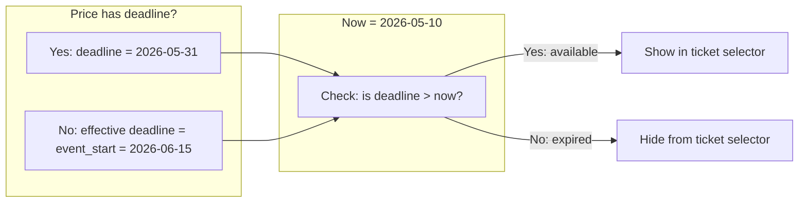
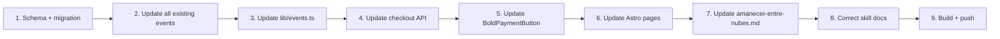

# Plan: Multi-Ticket Selection, Date Range, & Skill Corrections

## Overview

Three interconnected changes:

1. **Date range**: Replace single `event_date` with `event_start` + `event_end`
2. **Multi-ticket UI**: Users select ticket types, quantities, see running total
3. **Skill corrections**: Fix inaccuracies in `.agents/publish-new-event/SKILL.md`

---

## Architecture

```mermaid
flowchart TD
    subgraph "Event Frontmatter"
        A[event_start: 2026-06-15<br/>event_end?: 2026-06-16]
        B[prices:<br/>  - label: Preferencial amount: 150000<br/>  - label: General amount: 20000<br/>  - label: Estandar amount: 1000]
    end

    subgraph "Server"
        C[getAvailablePrices<br/>prices + event_start]
        D[Filter: each price's effective deadline<br/>= deadline ?? event_start]
        E[Return only prices where<br/>effective deadline > now]
        F[checkout.ts API<br/>validates tickets against<br/>server-side frontmatter]
    end

    subgraph "Client (BoldPaymentButton)"
        G[Receive available prices]
        H[User selects tickets + quantities]
        I[Running total displayed]
        J[POST /api/checkout<br/>{ tickets: [{label, qty}], customerData }]
    end

    A --> C
    B --> C
    C --> D --> E
    E --> G --> H --> I --> J
    J --> F
```

---

## Detailed Logic: Price Deadline Resolution

### Rule
> If a ticket has an explicit `deadline`, that's its cutoff date.
> If a ticket has **no** `deadline`, its effective deadline = `event_start`.

### Why `event_start`?
- Tickets must be purchased **before** the event begins
- Once the event starts, no more sales
- This means: a ticket without deadline is available "until the event starts"

### Behavior flow



### Example: "Amanecer entre nubes" (event_start = 2026-06-15)

| Ticket | Amount | deadline | Effective deadline | Available on May 10? |
|--------|--------|----------|-------------------|---------------------|
| Estándar | 1000 | — | 2026-06-15 | ✅ Yes |
| General | 20000 | — | 2026-06-15 | ✅ Yes |
| Preferencial | 150000 | 2026-05-20 | 2026-05-20 | ✅ Yes |

### Example: Event with time-escalated pricing

| Ticket | Amount | deadline | Effective deadline | Available on May 10? |
|--------|--------|----------|-------------------|---------------------|
| Early Bird | 50000 | 2026-04-30 | 2026-04-30 | ❌ No (expired) |
| Regular | 70000 | — | event_start = 2026-06-15 | ✅ Yes |

This preserves backward compatibility: existing events with `event_date` and prices with `deadline` work exactly as before.

---

## Changes Required

### 1. Schema — [`src/content.config.ts`](src/content.config.ts)

**Current:**
```typescript
event_date: z.date(),
```

**New:**
```typescript
event_start: z.date(),
event_end: z.date().optional(),
```

### 2. Existing events — all files in [`src/content/events/`](src/content/events/)

Rename `event_date` → `event_start` in ALL existing `.md` files. Add `event_end` where applicable (multi-day events). For single-day events, omit `event_end`.

Files to update:
- [`ceremonia-equinoccio.md`](src/content/events/ceremonia-equinoccio.md)
- [`cocina-consciente.md`](src/content/events/cocina-consciente.md)
- [`festival-bhakti.md`](src/content/events/festival-bhakti.md)
- [`holi-fest-2026.md`](src/content/events/holi-fest-2026.md)
- [`retiro-silencio.md`](src/content/events/retiro-silencio.md)
- [`taller-permacultura.md`](src/content/events/taller-permacultura.md)
- [`temazcal-del-poder-femenino.md`](src/content/events/temazcal-del-poder-femenino.md)
- [`yoga-sonido.md`](src/content/events/yoga-sonido.md)
- [`amanecer-entre-nubes.md`](src/content/events/amanecer-entre-nubes.md) (already created)

### 3. Helper — [`src/lib/events.ts`](src/lib/events.ts)

**New function `getAvailablePrices`:**
```typescript
export function getAvailablePrices(
  prices: { label: string; amount: number; deadline?: Date }[],
  eventStart: Date,
): { label: string; amount: number; deadline?: Date }[] {
  if (!prices || prices.length === 0) return [];
  const now = new Date();
  return prices.filter(price => {
    const effectiveDeadline = price.deadline
      ? new Date(price.deadline)
      : new Date(eventStart);
    return effectiveDeadline > now;
  });
}
```

**Update `getUpcomingEvents`:**
```typescript
export async function getUpcomingEvents() {
  const allEvents = await getCollection('events');
  const now = new Date();
  return allEvents
    .filter(event => {
      const eventEnd = event.data.event_end
        ? new Date(event.data.event_end)
        : new Date(event.data.event_start);
      return eventEnd >= now;
    })
    .sort((a, b) => {
      return new Date(a.data.event_start).getTime() - new Date(b.data.event_start).getTime();
    });
}
```

**`getCurrentPrice` remains** but update to use `eventStart` as default deadline:
```typescript
export function getCurrentPrice(
  prices: { label: string; amount: number; deadline?: Date }[],
  eventStart?: Date,
) {
  if (!prices || prices.length === 0) return null;
  const now = new Date();
  const activePrice = prices.find(price => {
    const effectiveDeadline = price.deadline
      ? new Date(price.deadline)
      : (eventStart ? new Date(eventStart) : new Date('9999-12-31'));
    return effectiveDeadline > now;
  });
  return activePrice || prices[prices.length - 1];
}
```

### 4. Events detail page — [`src/pages/events/[slug].astro`](src/pages/events/[slug].astro)

**Current:**
```astro
const { title, description, event_date, image, prices } = event.data;
const currentPrice = getCurrentPrice(prices);
const formattedDate = event_date.toLocaleDateString(...);
```

**New:**
```astro
const { title, description, event_start, event_end, image, prices } = event.data;
const availablePrices = getAvailablePrices(prices, event_start);
const formattedStart = event_start.toLocaleDateString(...);
const formattedEnd = event_end?.toLocaleDateString(...);
```

**Pass prices to BoldPaymentButton:**
```astro
<BoldPaymentButton
  client:load
  contentType="event"
  contentId={event.id}
  prices={availablePrices}
/>
```

**Remove static price breakdown** (lines 151-165) — replaced by BoldPaymentButton's dynamic total.

### 5. Pasadia page — [`src/pages/pasadias/[slug].astro`](src/pages/pasadias/[slug].astro)

Same approach: pass `prices` to BoldPaymentButton. Pasadias don't have `event_start`/`event_end`, so use `duration` for display and no deadline defaulting.

### 6. BoldPaymentButton — [`src/components/BoldPaymentButton.tsx`](src/components/BoldPaymentButton.tsx)

**New prop:**
```typescript
interface BoldPaymentButtonProps {
  contentType: 'event' | 'pasadia';
  contentId: string;
  prices: { label: string; amount: number }[];  // REPLACES single amount
  onSuccess?: (orderId: string) => void;
  onError?: (error: Error) => void;
}
```

**New state:**
```typescript
interface TicketSelection {
  label: string;
  amount: number;
  quantity: number;
}

const [ticketSelections, setTicketSelections] = useState<TicketSelection[]>(
  prices.map(p => ({ label: p.label, amount: p.amount, quantity: 0 }))
);

const totalAmount = ticketSelections.reduce(
  (sum, t) => sum + t.amount * t.quantity, 0
);
```

**UI changes in `idle` phase:**

Before the customer form, show ticket selection grid:
```
┌─────────────────────────────────────┐
│  Ticket preferencial     - 2 +      │
│  $150,000/ud    Subtotal: $300,000  │
├─────────────────────────────────────┤
│  Ticket general          - 1 +      │
│  $20,000/ud     Subtotal: $20,000   │
├─────────────────────────────────────┤
│  Ticket estandar         - 0 +      │
│  $1,000/ud      Subtotal: $0       │
├─────────────────────────────────────┤
│  Total: $320,000                    │
└─────────────────────────────────────┘
```

**API request body change:**
```typescript
// BEFORE
body: JSON.stringify({ contentType, contentId, quantity: 1, customerData })

// AFTER
body: JSON.stringify({
  contentType,
  contentId,
  tickets: ticketSelections.filter(t => t.quantity > 0),
  customerData,
})
```

### 7. Checkout API — [`src/pages/api/checkout.ts`](src/pages/api/checkout.ts)

**Parse tickets:**
```typescript
const { contentType, contentId, tickets, customerData } = body as {
  contentType?: string;
  contentId?: string;
  tickets?: { label: string; quantity: number }[];
  customerData?: { email?: string; fullName?: string; phone?: string; dialCode?: string };
};
```

**Validate against frontmatter:**
```typescript
// Read prices from Markdown (source of truth)
const prices = (entry.data as any).prices as { label: string; amount: number }[];
const eventStart = (entry.data as any).event_start as Date | undefined;

// Validate each ticket
for (const ticket of tickets) {
  const priceDef = prices.find(p => p.label === ticket.label);
  if (!priceDef) {
    return new Response(JSON.stringify({ error: `Invalid ticket: ${ticket.label}` }), { status: 400 });
  }
  if (ticket.quantity < 1) {
    return new Response(JSON.stringify({ error: `Invalid quantity for ${ticket.label}` }), { status: 400 });
  }
}

// Calculate total server-side
const totalAmount = tickets.reduce((sum, t) => {
  const priceDef = prices.find(p => p.label === t.label)!;
  return sum + priceDef.amount * t.quantity;
}, 0);

// Use totalAmount in Bold payload
```

**Quantity for stock:**
```typescript
const totalQuantity = tickets.reduce((sum, t) => sum + t.quantity, 0);
```

**Insert ticket_details in order:**
```typescript
await admin.from('orders').insert({
  bold_order_id: orderId,
  content_type: contentType,
  content_id: contentId,
  customer_email: customerData.email,
  customer_name: customerData.fullName,
  amount: totalAmount,
  currency: 'COP',
  status: 'pending',
  quantity: totalQuantity,
  ticket_details: tickets,  // NEW
});
```

### 8. Database migration — `supabase/migrations/005_add_ticket_details.sql`

```sql
ALTER TABLE orders ADD COLUMN ticket_details jsonb;
```

### 9. Skill corrections — [`.agents/publish-new-event/SKILL.md`](.agents/publish-new-event/SKILL.md)

| # | Current (incorrect) | Correct |
|---|---------------------|---------|
| 1 | "URL path derived from frontmatter `id`" | URL path derived from **filename** (entry ID). Frontmatter `id` is a persistent identifier but NOT used for routing. |
| 2 | "Payment orders reference events by `id`" | Payment system uses **entry ID** (filename). The frontmatter `id` field is not used by the payment flow. |
| 3 | `event_date: YYYY-MM-DD` | `event_start: YYYY-MM-DD` (required), `event_end: YYYY-MM-DD` (optional) |
| 4 | "If omitted, deadline is always available" | "If omitted, deadline defaults to `event_start`. Ticket is available until the event starts." |
| 5 | No mention of ticket selection | Add full section on multi-ticket UI |
| 6 | `getCurrentPrice` returns active price | Add `getAvailablePrices` — returns all prices with future deadlines |

---

## Implementation Order



### Step 1: Schema + DB migration
- Update [`src/content.config.ts`](src/content.config.ts): `event_date` → `event_start`, add optional `event_end`
- Create `supabase/migrations/005_add_ticket_details.sql`

### Step 2: Update all existing events
- Rename `event_date` → `event_start` in all 9 event `.md` files
- Add `event_end` where applicable

### Step 3: Update [`src/lib/events.ts`](src/lib/events.ts)
- Add `getAvailablePrices()` function
- Update `getUpcomingEvents()` to use `event_end` (or `event_start` if not set)
- Update `getCurrentPrice()` to accept optional `eventStart` for deadline defaulting

### Step 4: Update [`src/pages/api/checkout.ts`](src/pages/api/checkout.ts)
- Parse `tickets` array, validate against frontmatter
- Calculate total server-side
- Store `ticket_details` in order

### Step 5: Update [`src/components/BoldPaymentButton.tsx`](src/components/BoldPaymentButton.tsx)
- Accept `prices` prop
- Ticket selection UI with quantity controls
- Running total display
- Send tickets in API request

### Step 6: Update page templates
- [`src/pages/events/[slug].astro`](src/pages/events/[slug].astro): pass `availablePrices`, update date formatting
- [`src/pages/pasadias/[slug].astro`](src/pages/pasadias/[slug].astro): pass `prices`

### Step 7: Update [`src/content/events/amanecer-entre-nubes.md`](src/content/events/amanecer-entre-nubes.md)
- Change `event_date` → `event_start`

### Step 8: Correct skill docs
- [`.agents/publish-new-event/SKILL.md`](.agents/publish-new-event/SKILL.md)
- [`.agents/publish-new-event/references/step-by-step-instructions.md`](.agents/publish-new-event/references/step-by-step-instructions.md)
- [`.agents/publish-new-event/references/examples.md`](.agents/publish-new-event/references/examples.md)

### Step 9: Build & deploy
- `npm run build` to verify TypeScript
- Commit, push to GitHub, Vercel auto-deploys

---

## Edge Cases

1. **Single-day event**: Omit `event_end`. `getUpcomingEvents` uses `event_start` as end date.
2. **Ticket with explicit deadline after event_start**: Allowed. User can buy after event starts but before deadline. Example: online event where access is sold after start date.
3. **Zero tickets selected**: "Reservar ahora" disabled if `totalQuantity === 0`.
4. **Single price, no deadline**: Available until event_start (same as before for practical purposes).
5. **All deadlines passed**: No tickets shown. "Reservar ahora" should show "Entradas agotadas" or similar.
6. **Price manipulation prevention**: API reads prices from server-side Markdown, validates labels exist, calculates amounts server-side. Frontend only sends labels + quantities.
7. **Stock**: `quantity` in orders = sum of all ticket quantities. Stock is per-event, not per-ticket-type (v1 acceptable).
