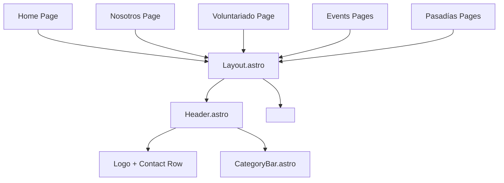

# Improved Navigation Architecture for Varsana Astro Project

## Overview

This document outlines the architectural design for integrating the CategoryBar navigation component into the Header, ensuring consistent navigation across all pages, proper active state detection, and responsive design.

## Goals

1. **Integration**: Move CategoryBar from individual pages into Header.astro as the main navigation menu.
2. **Consistency**: Ensure CategoryBar appears on all relevant pages (home, nosotros, voluntariado, events, pasadias) via Layout.astro.
3. **Active State Logic**: Implement robust route‑based active detection for all nine categories.
4. **Visual Cohesion**: Maintain the existing visual style (colors, borders, transitions) while adapting positioning.
5. **Responsive Behavior**: Keep the horizontal scrollable container for mobile devices.

## Component Architecture



**Key relationships**:
- `Layout.astro` imports and renders `Header.astro`.
- `Header.astro` contains two logical rows: the top row (logo & contact) and the navigation row (`CategoryBar.astro`).
- All pages use `Layout.astro`, thereby automatically receiving the updated header with integrated navigation.

## Updated Header.astro Specification

### Structural Changes

The current header consists of a single sticky row. The new structure will be:

```astro
---
import CategoryBar from '@/src/components/CategoryBar.astro';
---

<header class="sticky top-0 z-50 bg-white border-b border-gray-100">
  <div class="max-w-7xl mx-auto px-8 py-5 md:px-16 lg:px-24">
    <!-- Top row: logo & contact -->
    <div class="flex items-center justify-between">
      <!-- Logo -->
      <a href="/" class="flex items-center gap-3 cursor-pointer group">
        <div class="h-14 w-auto overflow-hidden">
          
        </div>
        <span class="text-2xl font-bold tracking-tightest hidden md:block font-display text-forest">Varsana</span>
      </a>

      <!-- Contact Info -->
      <div class="flex items-center gap-4 md:gap-8">
        <div class="flex flex-col md:flex-row items-end md:items-center gap-1 md:gap-6 text-sm font-semibold">
          <a href="tel:+573214538242" class="flex items-center gap-2 hover:text-rausch transition-colors">
            <Phone size={16} className="text-rausch" />
            <span class="hidden sm:inline">+57 321 4538242</span>
          </a>
          <a href="mailto:contacto@varsana.com" class="flex items-center gap-2 hover:text-rausch transition-colors">
            <Mail size={16} className="text-rausch" />
            <span class="hidden sm:inline">contacto@varsana.com</span>
          </a>
        </div>
        
        <div class="p-2 hover:bg-sacred-sand rounded-full cursor-pointer transition-colors hidden md:block">
          <Globe size={18} />
        </div>
      </div>
    </div>

    <!-- Navigation row -->
    <CategoryBar />
  </div>
</header>
```

### Key Adjustments

- Removed the `px-8 py-5 md:px-16 lg:px-24` from the outer `<header>` and moved it to the inner container to keep consistent horizontal padding for both rows.
- The `CategoryBar` component is placed directly after the top‑row flex container, inside the same `max‑w‑7xl` wrapper.
- The sticky positioning (`sticky top‑0`) remains on the `<header>` element, so the entire header (including the navigation bar) sticks to the top.

## Updated CategoryBar.astro Specification

### Active State Logic

Replace the hard‑coded active detection with a generic function that evaluates the current route against each category’s href.

```astro
---
import { ... } from 'lucide-react';

const categories = [
  { name: 'Yoga', icon: Heart, href: '/' },
  { name: 'Meditación', icon: Flower2, href: '/' },
  { name: 'Hospedaje', icon: Tent, href: '/' },
  { name: 'Nosotros', icon: Info, href: '/nosotros' },
  { name: 'Voluntariado', icon: Users, href: '/voluntariado' },
  { name: 'Pasadias', icon: Map, href: '/pasadias' },
  { name: 'Eventos', icon: Calendar, href: '/events' },
  { name: 'Naturaleza', icon: Leaf, href: '/' },
  { name: 'Retiros', icon: Compass, href: '/' },
];

const currentPath = Astro.url.pathname;

const isActive = (href) => {
  if (href === '/') return currentPath === '/';
  return currentPath.startsWith(href);
};
---

<div class="bg-white border-b border-gray-100 px-8 py-4 md:px-16 lg:px-24 overflow-x-auto no-scrollbar">
  <div class="max-w-7xl mx-auto flex items-center gap-8 md:gap-12">
    {categories.map((cat, i) => (
      <a
        href={cat.href}
        class={`flex flex-col items-center gap-2 min-w-fit group cursor-pointer border-b-2 transition-all duration-600 pb-2 ${
          isActive(cat.href)
            ? 'border-near-black opacity-100'
            : 'border-transparent opacity-60 hover:opacity-100 hover:border-saffron'
        }`}
      >
        <cat.icon size={24} strokeWidth={1.5} />
        <span class="text-xs font-semibold whitespace-nowrap">{cat.name}</span>
      </a>
    ))}
  </div>
</div>

<style>
  .no-scrollbar::-webkit-scrollbar {
    display: none;
  }
  .no-scrollbar {
    -ms-overflow-style: none;
    scrollbar-width: none;
  }
</style>
```

### Styling Changes

- Removed `sticky top‑[73px] z‑40` because the bar is now part of the sticky header.
- Reduced vertical padding from `py‑5` to `py‑4` to keep the overall header height manageable.
- Kept the same horizontal padding (`px‑8 md:px‑16 lg:px‑24`) to align with the top row.
- The active indicator (`border‑b‑2`) and hover effects remain unchanged.

## Route Mapping Table

| Category      | Href          | Active Path Pattern                     | Notes                                                                 |
|---------------|---------------|-----------------------------------------|-----------------------------------------------------------------------|
| Yoga          | `/`           | `currentPath === '/'`                   | Represents the homepage; active only on exact match.                  |
| Meditación    | `/`           | `currentPath === '/'` (placeholder)     | Placeholder link; inactive unless on home.                            |
| Hospedaje     | `/`           | `currentPath === '/'` (placeholder)     | Placeholder link; inactive unless on home.                            |
| Nosotros      | `/nosotros`   | `currentPath.startsWith('/nosotros')`   | Includes team‑member detail pages (`/nosotros/*`).                    |
| Voluntariado  | `/voluntariado` | `currentPath.startsWith('/voluntariado')` | No subpages currently.                                                |
| Pasadias      | `/pasadias`   | `currentPath.startsWith('/pasadias')`   | Includes detail pages (`/pasadias/*`).                                |
| Eventos       | `/events`     | `currentPath.startsWith('/events')`     | Includes detail pages (`/events/*`).                                  |
| Naturaleza    | `/`           | `currentPath === '/'` (placeholder)     | Placeholder link; inactive unless on home.                            |
| Retiros       | `/`           | `currentPath === '/'` (placeholder)     | Placeholder link; inactive unless on home.                            |

## CSS / Tailwind Adjustments

### 1. Header Height
- The total header height will increase because of the added navigation row.
- Approximate heights:
  - Top row: `56px` (logo) + `40px` (py‑5) = `≈96px`
  - Navigation row: `24px` (icon) + `16px` (text) + `32px` (py‑4 + pb‑2) = `≈72px`
  - Total sticky header height: `≈168px`
- **Action**: Adjust the `padding‑top` of main content areas to prevent hiding behind the sticky header. Recommended to add `pt‑[168px]` or a comparable value to the `<main>` element in `Layout.astro` or to each page’s main container.

### 2. Responsive Behavior
- The `overflow‑x‑auto` and `no‑scrollbar` utilities are retained for mobile horizontal scrolling.
- No hamburger menu is introduced at this stage (per requirement).

### 3. Border Consistency
- The outer `<header>` already has `border‑b border‑gray‑100`.
- The `CategoryBar` also carries a `border‑b border‑gray‑100`; this creates a subtle separator between the two rows. The double border is acceptable, but if a single border is preferred, remove the border from `CategoryBar` and rely on the header’s border.

### 4. Active State Visuals
- Active items use `border‑near‑black` and `opacity‑100`.
- Inactive items have `opacity‑60` and a transparent border that changes to `saffron` on hover.
- Transition duration is `duration‑600` (600ms) for smooth hover/active effects.

## Implementation Steps

1. **Update `Header.astro`**  
   - Integrate `CategoryBar` as shown in the specification.
   - Adjust padding structure to maintain alignment.

2. **Update `CategoryBar.astro`**  
   - Replace the static active detection with the `isActive` function.
   - Remove sticky positioning and adjust vertical padding.

3. **Update `Layout.astro`**  
   - Remove any explicit `CategoryBar` import (now handled by Header).
   - Optionally add a CSS custom property for header height to simplify future adjustments.

4. **Remove `CategoryBar` from individual pages**  
   - Delete the `import CategoryBar` and `<CategoryBar />` lines from:
     - `src/pages/index.astro`
     - `src/pages/nosotros.astro`
     - `src/pages/voluntariado.astro`
   - (The events and pasadías pages already lack the CategoryBar; no changes needed there.)

5. **Adjust Main Content Padding**  
   - Evaluate the need for increased `padding‑top` on page main containers. Start by adding `pt‑40` (or a similar value) to the `<main>` element in `Layout.astro` and test across viewports.

6. **Test Active States**  
   - Navigate to `/`, `/nosotros`, `/voluntariado`, `/events`, `/pasadias` and verify the correct category is highlighted.
   - Verify that sub‑pages (e.g., `/events/[slug]`) also highlight the parent category.

7. **Responsive Testing**  
   - Check that the horizontal scroll works on mobile viewports.
   - Ensure the header does not overflow or cause layout shifts.

## Testing Considerations

- **Visual Regression**: Compare before/after screenshots for home, nosotros, voluntariado, events, and pasadías pages.
- **Accessibility**: Confirm that keyboard navigation and screen‑reader announcements work correctly for the navigation links.
- **Performance**: The changes are purely presentational; no impact on bundle size or runtime performance is expected.
- **Cross‑browser**: Verify scrolling behavior and sticky positioning in Chrome, Firefox, Safari, and mobile browsers.

## Conclusion

This design provides a clean, maintainable navigation architecture that meets all stated requirements. The integration of `CategoryBar` into `Header.astro` ensures consistent navigation across the site, while the improved active‑state logic offers a precise user experience. The visual style is preserved, and the responsive behavior remains unchanged.

The plan is ready for implementation in **Code** mode.